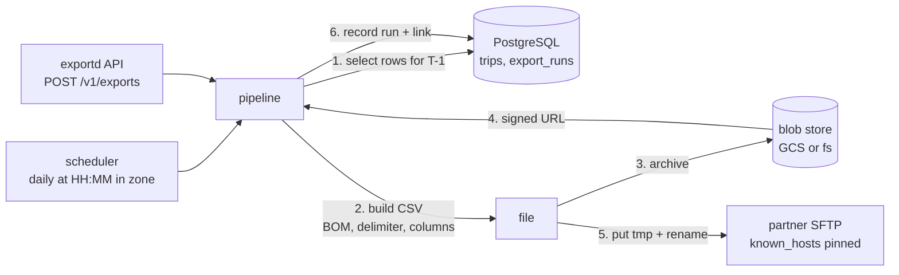

# go-partner-export

[](https://github.com/Nguyenngoctruong274/go-partner-export/actions/workflows/ci.yml)


[](LICENSE)

A daily partner-file export pipeline in Go. Every day it selects yesterday's
rows from PostgreSQL, writes them as the CSV the partner specified, archives
a copy in object storage (Google Cloud Storage or a directory), signs a
time-limited download link to that copy, pushes the file to the partner's
SFTP server and records the run so that a failed day can be replayed.

> 🚧 Built in public as a 10-day series. See the [roadmap](#roadmap) for progress.

## Why

"Send the partner a CSV every night" is one of the most common backend jobs
and one of the easiest to get subtly wrong. This project answers the questions
that job raises, with code and tests:

- **Which day is "yesterday"?** The report day is cut in the partner's time
  zone, not in UTC, so a run at 01:00 Ho Chi Minh time covers the whole
  previous local day, no matter where the pod runs.
- **What exactly did we send?** A copy of every file is archived before it
  is pushed, and the run record holds a signed URL to that copy. Finance can
  open it from a dashboard without a bucket IAM role.
- **How is the link signed?** With the GCS V4 algorithm: a canonical request
  is hashed and signed with a service-account RSA key, and the signature goes
  into the query string. The project implements and documents the steps,
  including what a key file must contain and why Application Default
  Credentials alone are not enough.
- **Is the SFTP delivery safe?** Host keys are pinned through `known_hosts`
  (no `InsecureIgnoreHostKey` outside local development), the file is
  uploaded under a temporary name and renamed, so the partner never picks up
  a half-written file, and missing remote directories are created.
- **What happens when a stage fails?** Each run is a small state machine
  (`pending → built → archived → pushed`, or `failed` with the stage and
  reason). Archive and push are retried with backoff, and a day can be
  re-run idempotently: the same date overwrites the same object and remote
  file name.
- **Money stays exact.** Amounts are integers in minor units from the
  database to the CSV; no `float64` is involved anywhere.

## Architecture



The diagram is the target design; the [roadmap](#roadmap) shows what is
built so far.

| Package | Responsibility |
|---|---|
| `cmd/exportd` | Service wiring, graceful shutdown; later the scheduler and a `--once` mode for Kubernetes CronJobs |
| `internal/config` | Environment configuration with validation; secrets are never echoed |
| `internal/httpapi` | Probes; later `/v1/exports` to trigger, inspect and re-push runs |
| `internal/export` *(day 2)* | Report window in a zone, file naming, CSV building (no I/O) |
| `internal/postgres` *(day 3)* | Migrations, rows to export, run history |
| `internal/blob` *(days 4–5)* | `Store` interface; `fs` and `gcs` drivers; V4 signed URLs |
| `internal/sftp` *(day 6)* | SSH/SFTP client: key or password auth, pinned host keys, atomic upload |
| `internal/pipeline` *(day 7)* | Orchestration, retries, run state machine |

## Quick start

```bash
make up          # PostgreSQL, an SFTP stand-in (atmoz/sftp) and a GCS emulator in Docker
make run         # exportd on :8080 with the local defaults from the Makefile
curl localhost:8080/healthz   # {"status":"ok"}
curl localhost:8080/readyz    # {"status":"ready"}; 503 while shutting down
make test        # unit tests with the race detector
make stack       # exportd and its dependencies together in Docker
```

The Makefile exports local defaults (fs blob driver, password auth to the
SFTP stand-in, host key check skipped) so that `make run` needs no `.env`.
Those defaults are for local use only; see the next section for a real
deployment.

## Configuration

Everything is read from the environment with the prefix `PX_`. Invalid values
are reported all at once, so a broken deployment fails on the first start
with the complete list. Secrets never appear in error messages.

The example values below are placeholders. Replace them with your own and
keep secrets in a secret manager or Kubernetes `Secret`, never in the chart
or the repository.

### Service

| Variable | Default | Description |
|---|---|---|
| `PX_HTTP_ADDR` | `:8080` | Listen address for probes and the API |
| `PX_LOG_LEVEL` | `info` | `debug`, `info`, `warn` or `error` |
| `PX_SHUTDOWN_TIMEOUT` | `15s` | Deadline for in-flight requests after the listener closes |
| `PX_SHUTDOWN_DRAIN` | `0s` | How long `/readyz` fails before the listener closes (a few seconds behind a load balancer) |
| `PX_DATABASE_URL` | *required* | `postgres://partner:<password>@db.internal:5432/partner?sslmode=require` |
| `PX_DB_MAX_CONNS` | `10` | Connection pool cap, 1–1000 |

### Report

| Variable | Default | Description |
|---|---|---|
| `PX_REPORT_TIMEZONE` | `Asia/Ho_Chi_Minh` | IANA zone the report day is cut in |
| `PX_REPORT_SCHEDULE_AT` | `01:00` | Local time (`HH:MM`) of the daily run |
| `PX_FILE_PREFIX` | `PartnerAccrual` | First part of the file name agreed with the partner |
| `PX_FILE_VERSION` | `v1` | Layout version in the file name; bump it when columns change |
| `PX_CSV_DELIMITER` | `\|` | Field separator; one character, not a quote or a line break |

Files are named `<prefix>_<version>_<YYYYMMDD>_<seq>.csv`, for example
`PartnerAccrual_v1_20261028_001.csv` for the report of 28 October 2026.

### Blob archive and signed URLs

| Variable | Default | Description |
|---|---|---|
| `PX_BLOB_DRIVER` | `fs` | `fs` (a directory) or `gcs` |
| `PX_BLOB_PREFIX` | `partner-export` | Folder inside the bucket or directory |
| `PX_BLOB_FS_ROOT` | `./data/blob` | Directory used by the `fs` driver |
| `PX_BLOB_BUCKET` | *required for gcs* | GCS bucket, e.g. `acme-fin-prod` |
| `PX_GCS_CREDENTIALS_FILE` | *(ADC)* | Optional service-account JSON for the storage client. Empty uses Application Default Credentials: Workload Identity on GKE, `GOOGLE_APPLICATION_CREDENTIALS`, or `gcloud auth application-default login` |
| `PX_GCS_SIGNER_KEY_FILE` | *required for gcs* | Service-account JSON key whose private key signs download URLs, e.g. `/var/run/secrets/gcs/signer.json` |
| `PX_SIGNED_URL_TTL` | `168h` | Validity of a download link, 1 minute to 7 days (the GCS maximum) |

**What the GCS setup needs**

1. A bucket (`PX_BLOB_BUCKET`). Objects are written under
   `<PX_BLOB_PREFIX>/<file name>`, so one bucket can serve several partners.
2. A service account for the writer with `roles/storage.objectCreator` and
   `roles/storage.objectViewer` on that bucket. On GKE, bind it through
   Workload Identity and leave `PX_GCS_CREDENTIALS_FILE` empty.
3. A service account **key file** for signing (`PX_GCS_SIGNER_KEY_FILE`). A
   V4 signed URL is an RSA-SHA256 signature over a canonical request, and
   producing it needs the private key material: the JSON key's
   `client_email` becomes `X-Goog-Credential` and its `private_key` signs
   the string. Workload Identity exposes no private key, which is why this
   file is separate from the client credentials. The signer only needs to
   be *allowed to read* the object (`roles/storage.objectViewer`), because
   anyone holding the URL acts as that account for the TTL.
4. Mount the key file from a Secret and reference it by path. Never put the
   JSON into an environment variable or a chart.

**How a signed URL is generated** (implemented on day 5)

```
canonical request = GET \n /<bucket>/<object> \n <sorted query> \n host:storage.googleapis.com \n\n host \n UNSIGNED-PAYLOAD
string to sign    = GOOG4-RSA-SHA256 \n <YYYYMMDD'T'HHMMSS'Z'> \n <YYYYMMDD>/auto/storage/goog4_request \n SHA256(canonical request)
signature         = hex( RSA-SHA256( service-account private key, string to sign ) )
url               = https://storage.googleapis.com/<bucket>/<object>?X-Goog-Algorithm=GOOG4-RSA-SHA256
                    &X-Goog-Credential=<client_email>/<YYYYMMDD>/auto/storage/goog4_request
                    &X-Goog-Date=<timestamp>&X-Goog-Expires=<seconds>&X-Goog-SignedHeaders=host&X-Goog-Signature=<signature>
```

GCS recomputes the same signature with the account's public key; if it
matches and `X-Goog-Date + X-Goog-Expires` is in the future, the object is
served. Nothing is stored on the GCS side, so a link cannot be revoked
before it expires, which is why the TTL is capped and the run record only
holds the link rather than exposing it on an unauthenticated endpoint.

### Partner SFTP

| Variable | Default | Description |
|---|---|---|
| `PX_SFTP_HOST` | *required* | e.g. `sftpgw.partner.example` |
| `PX_SFTP_PORT` | `22` | 1–65535 |
| `PX_SFTP_USER` | *required* | Login the partner issued, e.g. `acme-prod` |
| `PX_SFTP_AUTH` | `key` | `key` (private key file) or `password` |
| `PX_SFTP_PRIVATE_KEY_FILE` | *required for key* | PEM private key (OpenSSH, PKCS#8 or PKCS#1), e.g. `/var/run/secrets/sftp/id_ed25519` |
| `PX_SFTP_PASSWORD` | *required for password* | Password; mount it from a Secret |
| `PX_SFTP_KNOWN_HOSTS_FILE` | *required* | OpenSSH `known_hosts` entry that pins the server's host key |
| `PX_SFTP_INSECURE_SKIP_HOST_KEY` | `false` | Skip host-key verification. Local stand-ins only; the service logs a warning when set |
| `PX_SFTP_REMOTE_DIR` | `input` | Directory the file is written into, relative to the login directory; created when missing |
| `PX_SFTP_TIMEOUT` | `30s` | Dial and handshake timeout |

**What the SFTP setup needs**

1. Credentials from the partner: a login plus either a password or a key
   pair. For key auth, generate the pair yourself and hand over only the
   public half:
   ```bash
   ssh-keygen -t ed25519 -f sftp_id_ed25519 -N '' -C 'acme-prod export'
   # send sftp_id_ed25519.pub to the partner; mount sftp_id_ed25519 as a Secret
   ```
2. The server's host key, pinned so a DNS hijack cannot redirect the file:
   ```bash
   ssh-keyscan -p 22 sftpgw.partner.example > known_hosts   # verify the fingerprint with the partner
   ```
3. The target directory (`PX_SFTP_REMOTE_DIR`), usually `input` or
   `<your-company>/input` in the partner's layout. The job creates missing
   segments, but the login must be allowed to write there.

### Retries

| Variable | Default | Description |
|---|---|---|
| `PX_RETRY_ATTEMPTS` | `3` | Attempts per stage (archive, push), 1–10 |
| `PX_RETRY_BACKOFF` | `2s` | Base delay between attempts, up to 1 minute |

### Kubernetes example

A CronJob with every secret mounted from a `Secret` named `partner-export`.
The values are placeholders.

```yaml
apiVersion: batch/v1
kind: CronJob
metadata:
  name: partner-export
spec:
  schedule: "0 18 * * *"          # 01:00 Asia/Ho_Chi_Minh, expressed in UTC
  jobTemplate:
    spec:
      template:
        spec:
          serviceAccountName: partner-export   # bound to a GCP SA via Workload Identity
          restartPolicy: OnFailure
          containers:
            - name: exportd
              image: ghcr.io/example/go-partner-export:1.0.0
              args: ["--once"]                 # day 8: run one report and exit
              env:
                - name: PX_DATABASE_URL
                  valueFrom: { secretKeyRef: { name: partner-export, key: database_url } }
                - name: PX_REPORT_TIMEZONE
                  value: Asia/Ho_Chi_Minh
                - name: PX_FILE_PREFIX
                  value: PartnerAccrual
                - name: PX_BLOB_DRIVER
                  value: gcs
                - name: PX_BLOB_BUCKET
                  value: acme-fin-prod
                - name: PX_GCS_SIGNER_KEY_FILE
                  value: /var/run/secrets/gcs/signer.json
                - name: PX_SFTP_HOST
                  value: sftpgw.partner.example
                - name: PX_SFTP_USER
                  value: acme-prod
                - name: PX_SFTP_AUTH
                  value: key
                - name: PX_SFTP_PRIVATE_KEY_FILE
                  value: /var/run/secrets/sftp/id_ed25519
                - name: PX_SFTP_KNOWN_HOSTS_FILE
                  value: /var/run/secrets/sftp/known_hosts
                - name: PX_SFTP_REMOTE_DIR
                  value: input
              volumeMounts:
                - { name: gcs-signer, mountPath: /var/run/secrets/gcs, readOnly: true }
                - { name: sftp,       mountPath: /var/run/secrets/sftp, readOnly: true }
          volumes:
            - name: gcs-signer
              secret: { secretName: partner-export, items: [{ key: gcs_signer_json, path: signer.json }] }
            - name: sftp
              secret:
                secretName: partner-export
                items:
                  - { key: sftp_private_key, path: id_ed25519 }
                  - { key: sftp_known_hosts, path: known_hosts }
```

## Roadmap

- [x] **Day 1**: Scaffold: full configuration with validation, probes, slog, graceful shutdown, Docker, compose with PostgreSQL + SFTP + GCS emulator, CI
- [ ] **Day 2**: Export domain: report window in a zone, file naming with version and sequence, CSV builder (BOM, delimiter, column order), integer money; table tests and fuzzing
- [ ] **Day 3**: Schema and migrations: rows to export and `export_runs`; store with upsert, window query and run upsert by date; isolated test schemas
- [ ] **Day 4**: Blob store: `Store` interface, `fs` driver, `gcs` driver against the emulator; content types; retries with backoff
- [ ] **Day 5**: Signed URLs: GCS V4 signing with a service-account key, verified against a fixed key and clock; HMAC-signed links for the `fs` driver
- [ ] **Day 6**: SFTP client: key and password auth, `known_hosts` pinning, mkdir -p, upload under a temporary name then rename; tests against an in-process SSH/SFTP server
- [ ] **Day 7**: Pipeline: run state machine, per-stage retries, idempotent re-run of a date; end-to-end test over PostgreSQL, the emulator and the SFTP server
- [ ] **Day 8**: Scheduler at local time and `--once` mode for CronJobs; HTTP API to trigger, inspect, list and re-push runs
- [ ] **Day 9**: Metrics (rows, bytes, stage durations, failures) and alerts; benchmarks for CSV building
- [ ] **Day 10**: Final README, design decisions, Docker stack, v1.0.0

## License

[MIT](LICENSE)
